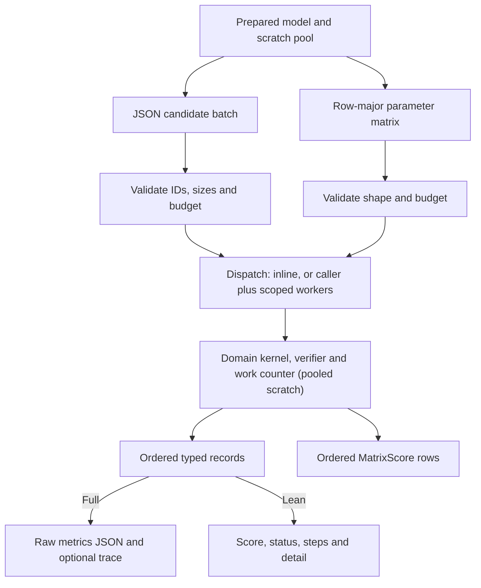

# Rail Craft architecture

Version 0.3.0. Evaluate dispatch weights for fixed routes through capacity-one resources
with entry closures and clearance. The [user manual](user-manual.md) documents every input
and API; this guide describes how evaluation works internally and what it costs.

## Evaluation pipeline

| Boundary | Location | Responsibility |
| --- | --- | --- |
| Request and CLI | `src/main.rs`, `src/lib.rs`, `models/request.json` | Versioned request schema, exact model-byte hash, typed validation, JSON output and exit code |
| Python boundary | `python/rail_craft/__init__.py`, PyO3 in `src/lib.rs` | Encode once per batch (JSON paths) or extract rows (matrix path), release the GIL during native evaluation, decode the typed result |
| Prepared engine | `src/lib.rs` | Own immutable domain data and the scratch pool, enforce batch rules, dispatch candidates and keep results in input order |
| Domain | `src/domain.rs` | Bind the candidate, run the dispatch simulation, verify the trace, classify status and compute the minimization objective |
| Campaign | `python/rail_craft/campaign.py` | Local SQLite replay, attempt journal and complete-result caching |
| Verification | `validation/`, `examples/`, `evidence/` | Independent checks, executable examples and paired performance observations |

## Data and execution contracts

`Prepared::new` hashes the model bytes, deserializes the model and validates its bounds
before building the prepared domain data. The Python wrapper encodes models with sorted
keys and finite JSON numbers. Two inputs that differ in their serialized representation
can have different provenance hashes. Result and request schema tags remain at 0.1; the
package version is reported separately. `Prepared::model_sha256` exposes the hash to Rust
callers.

Every JSON batch validates candidate count (1 to 4,096), unique IDs (1 to 128 bytes),
parameter vector length (up to 64), requested workers (1 to 64), step budget, deadline and
trace count (up to 16). All batches share one dispatch routine. With one worker or one
candidate, evaluation runs inline on the calling thread. Otherwise the calling thread and
`min(workers, candidates) - 1` scoped threads claim indexes through an atomic cursor, so
`min(workers, candidates)` evaluators run concurrently. Each index owns a result slot
written once, and results are assembled in input order after the threads join. The typed
envelope borrows candidate IDs until serialization completes. The CLI keeps its
`Value`-based request path.

`Work` counts domain-defined steps per candidate. Its fast branch handles unmonitored
steps below the limit. When `wall_ms` or `cancel_file` is set, every step takes the
monitored branch, which checks the cancel file, then the batch deadline, then the work
budget. Domain checks can reject an invalid candidate before it takes a step.
Cancellation and deadlines are cooperative. The wall clock can change which candidates
finish, while fixed-work replays agree for every worker count. Concurrent callers should
account for total worker demand when choosing batch settings.

Full records contain domain metrics and any requested trace. `scores_json` in Rust and
`Prepared.scores` in Python return the same record keys with null metrics and reject
traced candidates. Both keep per-candidate limits, the full feasibility audit, numeric
score checks and failure status. Full replay restores inspection details for the
selected candidate.

### Typed score matrix

`Prepared::score_matrix(rows, parameters, budget)` evaluates untraced candidates stored
row-major in one `f64` slice and returns one `MatrixScore { status, steps, score }` per
row. It parses only the budget JSON. It rejects row counts outside 1 to 4,096, a buffer
whose length is not a multiple of `rows`, and rows with more than 64 values; rows are
numbered by position and carry no IDs. Budget limits, deadline, dispatch, cancellation and
failure classification are the shared ones, and evaluation runs with metrics disabled,
exactly like `scores_json`. Unit tests compare status, steps and score bits with
`scores_json` for valid, invalid and infeasible rows, `max_steps` limits, a cancel file and
several worker counts. The PyO3 method takes `Vec<Vec<f64>>`, rejects ragged rows,
releases the GIL during evaluation and returns `(scores, statuses, steps)` with NaN for
every row that is not complete; the Python wrapper converts 2-D NumPy arrays with
`tolist()`.

### Metrics encoding

The domain builds metrics from typed structs whose fields are declared in sorted key
order, encodes them once with `serde_json::value::to_raw_value` and stores the resulting
`Box<RawValue>` in the record. The record serializer splices that raw JSON into the
output. Before 0.3.0, metrics were `serde_json::Value` maps, which serialize their keys
sorted; the typed field order reproduces those bytes, which a unit test checks for every
metrics shape. `Work::metrics` builds nothing in lean and matrix evaluations.

### Scratch pool

All per-candidate buffers of the kernel and the verifier live in `domain::Scratch`: train
and resource state, the contender table, ready masks, the event heap, the movement list
and the verifier's slot and grouping buffers. Each buffer is reset before use, so one
scratch serves any sequence of candidates and models. `Prepared` keeps a mutex-protected
pool of at most 64 scratch sets. The inline caller and every worker take one at the start
of a batch and return it at the end, so repeated single-candidate calls from an optimizer
reuse warm buffers instead of allocating about a dozen vectors per call.

## Domain internals

| State | Ownership |
| --- | --- |
| Routes, static event timeline, merged closure index, leg offsets | Immutable prepared corridor |
| Dynamic event heap, resource owners, free-after ticks, active closure counts | Candidate state in the scratch |
| Per-resource ready masks, contender table, next leg, held movement and arrival | Candidate state in the scratch |
| Movement list and verifier buffers | Candidate state in the scratch |

**Events.** An event is a packed `u64` key `(tick << 12) | (kind << 9) | index`, whose
unsigned order equals the `(tick, kind, index)` order. Ticks stay below 2^31 and indexes
below 512, so keys are unique and never reach `u64::MAX`. Releases and closure starts and
ends do not depend on the candidate; preparation sorts them once into a static timeline.
Each candidate walks the timeline with a cursor and merges it with a binary heap that holds
only service completions and clearance wakes, so the heap stays at most as large as the
number of trains plus resources. At a tick, events are processed in the order completions,
closure ends, closure starts, releases and clearance wakes. Every processed event is one
step.

**Dispatch.** Each resource has a 128-bit mask of the ready trains whose next leg uses it,
and a further 128-bit mask marks the resources that have at least one ready train. A
dispatch pass visits only those resources, checks each one's availability once (no owner,
clearance elapsed, no active closure) and ranks only the trains waiting for available
resources. Each ranking key is one `u128`: the high half maps the `f64` dispatch score to
an unsigned integer with the order of `f64::total_cmp`, and the low half is a tail
precomputed when the train became ready, which ranks an earlier waiting start and then a
lower train index higher. The pass takes the unsigned maximum. Weighted priority, waiting
start (as an exact `f64` integer) and tail live in one 128-entry contender table indexed by
`train & 127`, so the ranking loop has no bounds checks. The pass repeats until no train is
eligible; every dispatch is one step. A randomized unit test compares complete traced
output, steps and work-limit points with the 0.2.0 dispatcher on random corridors from
400 seeds, seven weight pairs and two step budgets.

**Verifier.** The independent verifier checks route continuity, entry closures, run
durations, release, horizon, capacity and clearance in three phases with fixed messages.
Each movement first passes the per-movement checks: an immutable per-resource index of
merged half-open closures answers the closure check with one binary search. The movement
is then placed in a per-train leg slot found through prepared prefix offsets. Without a
repeated slot, every train has all of its legs exactly when the movement count equals the
total leg count. A stable counting pass groups movements by resource; a group is sorted by
entry only when it is out of order. A randomized test compares verdicts and messages with
the 0.2.0 verifier on corrupted traces. Even lean and matrix evaluations run the complete
audit before reporting `complete`.

**Limits.** Models have at most 128 trains and 128 resources, enforced by model
validation since 0.1.0. The ready masks, the resource mask and the contender table depend
on these limits; raising them would need wider masks.

The synthetic corridor models blocking and a fixed priority policy. Timetable synthesis
and train dynamics are outside the supported input.

## Persistence and boundaries of evidence

The local campaign hashes the installed extension bytes plus each scenario, model,
candidate and work settings to locate reusable records. SQLite stores completed, invalid
and infeasible results, and keeps an append-only journal of attempts. Cancelled or
time-limited attempts remain in the journal and can be retried. SQLite commits each chunk
atomically. A new extension build changes the cache namespace. The current workflow is
local and exposes no distributed worker protocol.

The package contains source, a source distribution, and a validated Linux x86-64 wheel.
The [0.3.0 performance log](../rail-craft-performance-log-0.3.0.md) distinguishes the
native prepared boundary, complete Python search and clean build. See the
[tutorial](tutorial.md) for exact commands and [the model card](model.md) for equations
and research scope.

## Performance

All numbers in this section were measured for this release on one host: 2 vCPUs, Intel(R)
Xeon(R) Processor @ 2.10GHz (KVM guest), Rust 1.97.0, CPython 3.12.3. They are not
comparable with the 0.2.0 log's figures, which came from an AMD EPYC 9V74 host with
4 CPUs and Rust 1.88. Five independent projects shared the host; every timing ran under
a shared CPU lock so that no build or other benchmark overlapped it.

### 0.2.0 compared with 0.3.0

`validation/performance_pair.py` ran the 0.2.0 benchmark binary (built from the import
commit) against the round-10 binary with 11 alternating samples per side. Each sample is
a fresh process that excludes start-up and preparation, warms up the prepared evaluator
and reports the mean time per call over the workload's repeats. The paired script also
checks that both sides produce semantically identical records. Rows marked "baseline:
0.2.0 lean" compare 0.2.0 lean JSON scores with the 0.3.0 matrix API, because 0.2.0 has
no matrix API. The `parallel` workload keeps its four workers on this 2-vCPU host.

| Workload | Description | 0.2.0 ms | 0.3.0 ms | 0.2.0 / 0.3.0 |
| --- | --- | ---: | ---: | ---: |
| `one` | Single prepared evaluation, full record | 0.0019 | 0.0014 | 1.30x |
| `serial` | 96 full records, one worker | 0.149 | 0.084 | 1.76x |
| `parallel` | 96 full records, four workers | 0.365 | 0.200 | 1.82x |
| `trace` | 12 traced records | 0.102 | 0.030 | 3.40x |
| `invalid` | 1,024 invalid candidates | 1.504 | 1.468 | 1.02x |
| `domain` | 48 domain cases (110 trains, one resource) | 3.742 | 1.011 | 3.70x |
| `domain2` | 48 secondary cases (100 trains, 300 closures) | 4.398 | 0.954 | 4.61x |
| lean `serial` | 96 lean scores | 0.113 | 0.071 | 1.59x |
| lean `domain` | 48 lean domain scores | 3.388 | 0.839 | 4.04x |
| lean `domain2` | 48 lean secondary scores | 4.339 | 0.901 | 4.82x |
| matrix `serial` | 96 matrix rows (baseline: 0.2.0 lean) | 0.104 | 0.034 | 3.06x |
| matrix `domain` | 48 matrix domain rows (baseline: 0.2.0 lean) | 3.458 | 0.899 | 3.84x |
| lean `one` | One lean score (supplementary) | 0.0015 | 0.0011 | 1.32x |
| matrix `one` | One matrix row (baseline: 0.2.0 lean, supplementary) | 0.0015 | 0.0005 | 3.01x |
| matrix `domain2` | 48 matrix secondary rows (baseline: 0.2.0 lean, supplementary) | 4.498 | 0.881 | 5.10x |
| matrix `parallel` | 96 matrix rows, four workers (baseline: 0.2.0 lean, supplementary) | 0.259 | 0.159 | 1.63x |

Evidence: `evidence/performance-0.3.0/cumulative/*.json`. An earlier complete run of the
same table is kept in `cumulative/run1/`; a host slowdown affected both sides during
samples 1 to 8 of its matrix `domain` row, so the table was repeated once and the
repeat is reported. Between the two runs, the ratios differ most for matrix `parallel`
(2.13x and 1.63x) and lean `domain` (3.58x and 4.04x); every other row differs by at
most 0.21. Treat differences of this size as run-to-run noise on a shared virtual host.

### Where a call spends its time

The benchmark's `breakdown` probe times, separately and on the same inputs, JSON decoding
of the candidates and budget alone, the matrix API (evaluation without JSON), the lean JSON
call and the full JSON call. Each value is the median of 11 loops
(`evidence/performance-0.3.0/breakdown.json`, release binary, one worker except
`parallel`). The two right-hand columns are differences of independent medians, so they
are estimates; small negative values mean that the parts are within noise of each other.

| Workload | Candidates | Decode us | Matrix us | Lean us | Full us | Lean - decode - matrix us | Full - lean us |
| --- | ---: | ---: | ---: | ---: | ---: | ---: | ---: |
| `one` | 1 | 0.24 | 0.49 | 1.19 | 1.40 | 0.46 | 0.21 |
| `serial` | 96 | 19.38 | 37.21 | 74.71 | 95.07 | 18.12 | 20.36 |
| `parallel` (4 workers) | 96 | 19.81 | 144.62 | 195.29 | 206.26 | 30.86 | 10.98 |
| `trace` | 12 | 3.18 | n/a | n/a | 23.20 | n/a | n/a |
| `invalid` | 1,024 | 1,185.37 | 18.70 | 1,347.25 | 1,330.45 | 143.18 | -16.80 |
| `domain` | 48 | 7.06 | 895.84 | 888.26 | 931.64 | -14.64 | 43.38 |
| `domain2` | 48 | 9.68 | 851.98 | 856.95 | 950.78 | -4.71 | 93.83 |

"Lean - decode - matrix" is the cost of ID checks, record assembly and JSON encoding;
"full - lean" is the cost of building and encoding metrics. Inside the evaluation,
callgrind instruction counts (`evidence/performance-0.3.0/instruction-profile.json`)
attribute the work of a matrix call as follows:

| Matrix workload | Domain evaluation share of the call | Verifier share of domain evaluation |
| --- | ---: | ---: |
| `serial` (two trains, 21 steps) | 97.3% | 23.0% |
| `domain` (110 trains) | 99.9% | 6.3% |
| `domain2` (100 trains, 300 closures) | 99.9% | 9.8% |

For the large cases the remaining domain time is the event loop and the dispatch ranking.

### Per-call cost of the three APIs

Per candidate, from the same breakdown (us):

| Workload | Matrix | Lean | Full |
| --- | ---: | ---: | ---: |
| `one` (single call) | 0.495 | 1.188 | 1.396 |
| `serial` (96 per call) | 0.388 | 0.778 | 0.990 |
| `domain` (48 per call) | 18.663 | 18.505 | 19.409 |
| `domain2` (48 per call) | 17.750 | 17.853 | 19.808 |
| `invalid` (1,024 per call, 63 parameters each) | 0.018 | 1.316 | 1.299 |

For small models the matrix API halves the cost per candidate against lean JSON records
and is 2.8 times cheaper than full records for a single call. For large models, simulation
dominates and the APIs differ by at most 12%. JSON decoding of many parameters is
expensive: the `invalid` batch spends 1.19 ms of 1.33 ms decoding 64,512 numbers, which
the matrix API avoids.

### Worker scaling

Median time per call over 11 alternating process runs per worker count
(`evidence/performance-0.3.0/worker-scaling.json`, `CRAFT_WORKERS` override), in ms:

| Workload | API | 1 worker | 2 workers | 4 workers | 8 workers |
| --- | --- | ---: | ---: | ---: | ---: |
| `serial` | full | 0.095 | 0.151 | 0.210 | 0.473 |
| `serial` | lean | 0.073 | 0.137 | 0.218 | 0.465 |
| `serial` | matrix | 0.037 | 0.085 | 0.171 | 0.309 |
| `domain` | full | 1.122 | 0.648 | 0.804 | 1.104 |
| `domain` | lean | 0.969 | 0.578 | 0.659 | 0.871 |
| `domain` | matrix | 0.866 | 0.556 | 0.556 | 0.708 |
| `domain2` | full | 0.869 | 0.533 | 0.598 | 0.769 |
| `domain2` | lean | 0.925 | 0.606 | 0.722 | 0.821 |
| `domain2` | matrix | 0.921 | 0.633 | 0.652 | 0.879 |

Two workers give 1.45 to 1.73 times the single-worker throughput on the large cases,
close to what 2 vCPUs allow after thread start-up. For the 96 small candidates (about 37 us of
work), every extra thread costs more than it saves. Workers beyond the CPU count only add
start-up and contention.

### Monitored budgets

`wall_ms` and `cancel_file` switch every step to the monitored branch
(`evidence/performance-0.3.0/budget-monitoring.json`, installed development wheel,
`score_matrix` with one worker, median us per call of 96 rows):

| Model | Steps per row | Default | `wall_ms=60000` | `cancel_file` (absent file) |
| --- | ---: | ---: | ---: | ---: |
| Example, two trains | 21 | 54.1 | 117.6 | 766.4 |
| 16-train corridor | 159 | 288.2 | 879.5 | 5,955.1 |

With a clock read per step a call takes 2 to 3 times as long, and with a file-system
check per step 14 to 21 times as long.

### Installed Python optimization

`validation/optimize_performance.py` runs SciPy differential evolution (seed 17, 16
objective calls) and a traced replay of the winner, pinned to one logical CPU with
`taskset -c 0`. Each configuration ran 7 times in an interleaved order; the 0.3.0 wheel was
built from the extracted source distribution and each wheel was installed in its own
fresh CPython 3.12 environment with NumPy 2.3.5 and SciPy 1.17.0. Times exclude Python
imports. The total median is computed per run
(`evidence/performance-0.3.0/python-optimization.json`).

| Configuration | Prepare ms | Search ms | Replay ms | Total ms | v0.2.0-full / total |
| --- | ---: | ---: | ---: | ---: | ---: |
| v0.2.0-full | 0.099 | 3.428 | 0.050 | 3.572 | 1.00x |
| v0.2.0-scores | 0.098 | 3.393 | 0.052 | 3.544 | 1.01x |
| v0.3.0-full | 0.095 | 3.280 | 0.039 | 3.476 | 1.03x |
| v0.3.0-scores | 0.093 | 3.359 | 0.043 | 3.495 | 1.02x |
| v0.3.0-matrix | 0.094 | 2.999 | 0.065 | 3.164 | 1.13x |

All 35 runs made 16 evaluations with 0 failures, selected
`[0.9178665376954516, 0.004332725510795259]` and replayed score 17. The search costs about
0.2 ms per objective call, while a native evaluation costs about 1.4 us: SciPy's own
bookkeeping dominates this short run. The matrix mode removes the JSON encoding and
decoding in Python and saves about 18 us per call. Its replay is the process's first JSON
call and includes that path's first-use cost.

### What dominates now and which API to use

- Large models (about 100 trains): the event loop and the dispatch ranking take 90% to
  94% of the evaluation and the verifier 6% to 10%; the API choice changes the cost by at
  most 12%. Use two workers on this 2-vCPU host for batches of a few dozen candidates or more.
- Small models: per-candidate kernel cost is below half a microsecond, so JSON decoding,
  record encoding and thread start-up dominate. Use `score_matrix` with one worker.
- Optimizers: use `score_matrix`, pass whole populations where the optimizer allows it,
  keep `cancel_file` and `wall_ms` out of the objective, and replay the winner with
  `evaluate(..., trace=True)`.
- Many parameters per candidate through JSON: decoding dominates; the matrix API avoids it.
- Use `batch` only when the metrics of every candidate are needed, and trace only replays.
