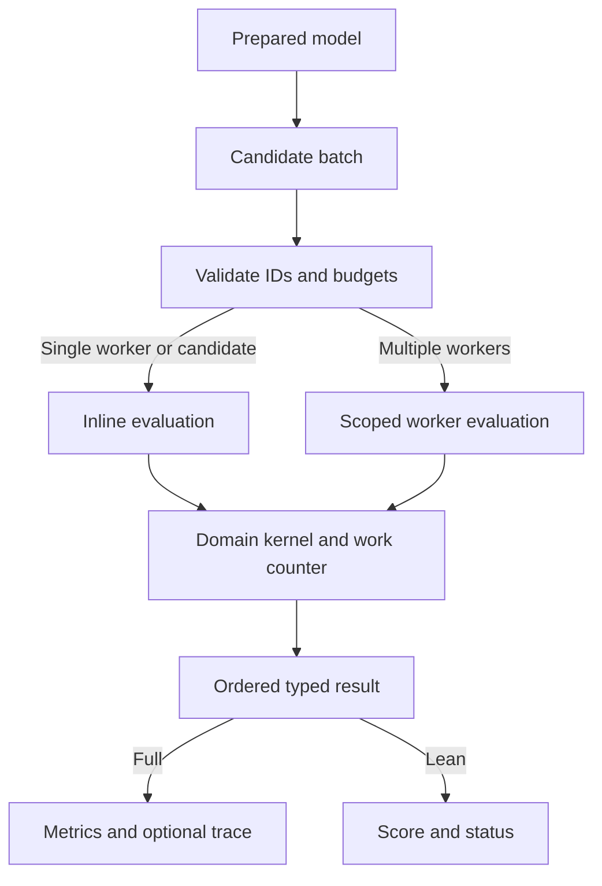

# Rail Craft architecture

Version 0.2.0. Evaluate dispatch weights for fixed routes through capacity-one resources with entry closures and clearance.

## Evaluation pipeline

| Boundary | Location | Responsibility |
| --- | --- | --- |
| Request and CLI | `src/main.rs`, `src/lib.rs`, `models/request.json` | Versioned request schema, exact model-byte hash, typed validation, JSON output and exit code |
| Python boundary | `python/rail_craft/__init__.py`, PyO3 in `src/lib.rs` | Encode once per batch, release the Python GIL during native evaluation, decode the typed result envelope |
| Prepared engine | `src/lib.rs` | Own immutable domain data, enforce batch rules, dispatch candidates and retain ordered result rows |
| Domain | `src/domain.rs` | Bind the candidate, execute model logic, classify status and compute a minimization objective |
| Campaign | `python/rail_craft/campaign.py` | Local SQLite replay, attempt journal and complete-result caching |
| Verification | `validation/`, `examples/`, `evidence/` | Independent checks, executable examples and paired performance observations |

## Data and execution contracts

`Prepared::new` hashes the model bytes, deserializes the model and
validates its bounds before building domain caches. The Python
wrapper encodes models with sorted keys and finite JSON numbers.
Two inputs that differ in their serialized representation can
have different provenance hashes. Result and request schema tags
remain at 0.1. Package version is reported separately.

Every batch validates candidate count (1–4096), unique IDs, parameter
vector length (up to 64), requested workers (1–64) and trace count
(up to 16). Parallel workers claim indexes through an atomic cursor.
Each assigned index owns a result slot written once. After workers
join, output is serialized in input order. Single-worker or singleton
calls run inline. The typed prepared envelope borrows candidate IDs
until serialization completes. The CLI retains its full `Value` API.

`Work` counts domain-defined steps per candidate. Its fast branch
handles unmonitored steps below the limit. Monitored steps check
the cancel file, then batch deadline, then work budget. Domain
checks can still reject an invalid candidate before it takes a step.
Cancellation and deadlines are cooperative. The wall clock can
change which candidates finish, while fixed-work replays should agree
independent of worker count. Candidate parallelism creates scoped
threads per batch. Concurrent callers should account for total
worker demand when choosing batch settings.

Full records contain domain metrics and any requested trace.
`scores_json` in Rust and `Prepared.scores` in Python return the
same record keys with null metrics and reject traced candidates.
Both retain per-candidate limits, diagnostics needed for feasibility,
numeric score checks and failure status. Full replay restores
inspection details for the selected candidate.

## Domain internals

| State | Ownership |
| --- | --- |
| Routes, initial events and closure index | Immutable prepared corridor |
| Current events, resource owners and free-after ticks | Candidate-local mutable state |
| Ready-train bitset, next leg, held interval and arrival | Candidate-local mutable state |
| Interval audit | Reconstructed from completed movement records |

A reverse binary heap orders by tick, event kind and stable index.
At each tick the engine applies service completions, closure ends,
closure starts, releases and clearance wakes before dispatch. It
then repeatedly picks the eligible train with highest weighted
priority plus waiting-age term, then earliest waiting time, then
input index. The engine clones the prepared release and closure heap
per candidate. Weighted priority is bound once for each train and
candidate. A 128-bit mask tracks ready trains in stable input order. Each selection pass ranks an eligible contender once.

The independent verifier checks route continuity, entry closures,
duration, release, horizon and resource clearance. It sorts
intervals by train and resource. An immutable index merges
overlapping or adjacent half-open closures per resource and uses a
binary search for each entry. The engine still tracks individual
closure events and overlapping closure counts. Even the lean
objective path runs the complete interval audit. The synthetic
corridor models blocking and a fixed priority policy. Timetable
synthesis and train dynamics are outside the supported input.

## Persistence and boundaries of evidence

The local campaign hashes the installed extension bytes plus each
scenario, model, candidate and work settings to locate reusable
records. SQLite stores completed, invalid and infeasible results,
and keeps an append-only journal of attempts. Cancelled or time-
limited attempts remain in the journal and can be retried. SQLite
commits each chunk atomically. A new extension build changes the
cache namespace. The current workflow is local and exposes no
distributed worker protocol.

The package contains source, a source distribution, and a validated
Linux x86-64 wheel. The included performance log distinguishes the
native prepared boundary, complete Python search and clean build.
See the [tutorial](tutorial.md) for exact commands and
[the model card](model.md) for equations and research scope.
